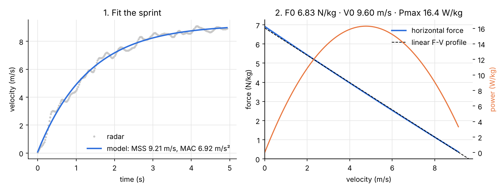
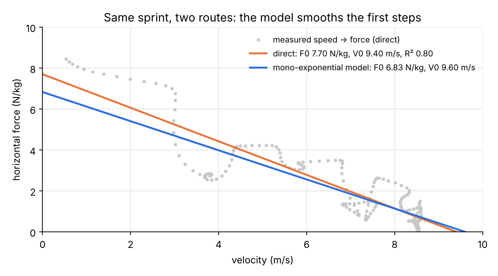
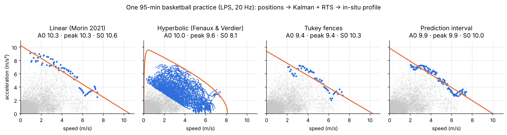
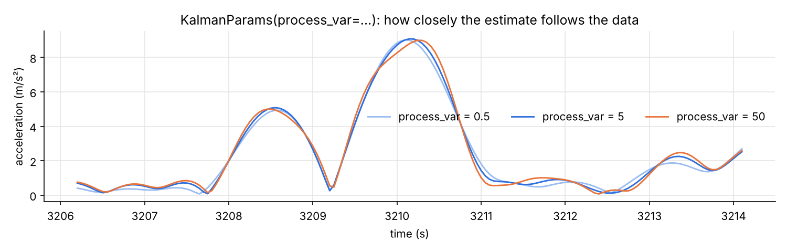

# sprintfv

[](https://github.com/Clement0242/sprintfv/actions/workflows/tests.yml)


**Sprint acceleration and force-velocity profiling in Python**: radar or laser
guns, timing gates, and GPS/LPS tracking data from training or matches.

The reference implementation of these methods is the R package
[{shorts}](https://github.com/mladenjovanovic/shorts) (Jovanović). In Python I
found notebooks, not a tested library. `sprintfv` reproduces every value published
in the {shorts} README, and adds what a sport scientist working with tracking
data needs: a configurable Kalman filter for raw positions and four methods
for in-situ acceleration-speed profiles, including the hyperbolic envelope.

🌐 **Project page:** https://clement0242.github.io/sprintfv/

*Version française plus bas.*

```bash
pip install git+https://github.com/Clement0242/sprintfv     # numpy + scipy only
```



## In five lines

```python
import sprintfv as s

d = s.load_jb_morin()                                   # a radar sprint shared by J-B. Morin
fit = s.fit_radar(d["time"], d["velocity"])             # MSS 9.21 m/s, MAC 6.92 m/s²
fv = s.force_velocity_profile(fit.mss, fit.mac, body_mass=75, body_height=1.72)
print(fv.summary())                                     # F0, V0, Pmax, SFV, RFmax, DRF
opt = s.optimal_profile(fv, distance=30)                # FV imbalance +44 %: train velocity
```

or from the command line:

```bash
sprintfv radar sprint.csv --mass 75 --height 1.72 --distance 30 --clean
sprintfv splits gates.csv --mass 60 --correction time
sprintfv insitu session.csv --method hyperbolic --process-var 5
```

## What is in it

| Module | Content |
|---|---|
| `model` | Mono-exponential sprint model, in closed form: v(t), x(t), a(t) and t(x) through the Lambert W function |
| `fit` | `fit_radar` (with time correction, or MSS fixed to the observed peak) and `fit_splits` (no correction, time correction or flying-start distance), with standard errors |
| `fvp` | Samozino et al. (2016) force-velocity-power profile with air resistance (F0, V0, Pmax, SFV, RFmax, DRF), model-based or **direct from a sensor trace** (`force_velocity_from_trace`); the analytic variant identical to {shorts}; the optimal profile over a distance and the FV imbalance (Samozino et al. 2022), simulated numerically so air resistance can be kept |
| `signal` | Cleaning of raw radar traces (km/h detection, isolated zeros, rolling outliers, zero-phase Butterworth) and detection of the end of the acceleration phase |
| `kalman` | Positions → speed and acceleration: Kalman filter + RTS smoother on a chain of integrators, **every parameter exposed** (`KalmanParams`), gaps, segments, court bounds, optional Butterworth pre-filter |
| `insitu` | Acceleration-speed profile from training or match data, four methods: `linear` (Morin et al. 2021), `hyperbolic` (F. Fenaux & C. Verdier), `tukey`, `prediction_interval` |

## Two routes to the force-velocity profile

**Model-based**, the "simple method" of Samozino et al. (ISB 2013; *Scand J Med
Sci Sports* 2016). The mono-exponential model is fitted to as few as 5 split
times or to a radar trace, the horizontal force is derived from the model, and
the linear F-v regression gives F0, V0 and Pmax. Use it with timing gates.

```python
fit = s.fit_splits([10, 15, 20, 30, 40], [1.89, 2.54, 3.15, 4.31, 5.44])
fv = s.force_velocity_profile(fit.mss, fit.mac, body_mass=60)
```

**Direct.** When a sensor gives the speed itself (radar, laser, LPS/GPS), the
force is computed from the *measured* speed and its derivative (or from the
sensor's acceleration, or a Kalman filter's), and the linear regression is
fitted to those points. No exponential shape is imposed, and the R² is an
actual test of how linear the profile is.

```python
c = s.clean_radar(t, v)                                   # optional Butterworth
fv = s.force_velocity_from_trace(c.time, c.velocity, body_mass=75, body_height=1.72)
```



On Morin's sample sprint the direct route gives a higher F0 (7.7 against
6.8 N/kg), because the exponential model smooths the first steps, where the
measured acceleration is stronger. On a simulated sprint the two routes agree
within 3 %. Both are kept on purpose: comparing them is informative.

## In-situ profiles: four methods on one practice



```python
d = s.load_lps_session()                                # 95 min of basketball, LPS at 20 Hz
k = s.positions_to_kinematics(
    d["time"], d["x"], d["y"],
    kalman=s.KalmanParams(order=4, process_var=5, measurement_std=0.05),
    prefilter_hz=1.0, bounds=(-2, 32, -2, 17),
)
v, a = k.profile_points()                               # accelerating samples only
for method in s.IN_SITU_METHODS:
    print(s.fit_in_situ(v, a, method=method).summary())
```

**The hyperbolic method** (F. Fenaux & C. Verdier) chooses inliers by density above the
line a = 5 − v, then fits the upper envelope by minimising
λ · (area under the curve) + (number of points above it). It first fits a
linear-exponential curve, then the hyperbolic-exponential one from it:

  a(v) = √( a0/v0 · (2·v0 + vm − v) · (vm − v) ) · √( 1 − e^(−v/v1) )

Unlike a straight line it bends down at low speed, where nobody produces their
maximal acceleration in a game, so it separates the **intercept A0** from the
**peak acceleration actually produced**. Every constant is an argument:
`fit_in_situ(v, a, "hyperbolic", lambda_divisor=3000, lambda_scale=0.8, k_neighbors=50, density_quantile=0.99, floor_line=(-1, 5))`.

**The Kalman filter** is written in NumPy, with no `filterpy` dependency. Its
estimates match `filterpy`'s `batch_filter` + `rts_smoother` to 1e-12 in the
tests. `process_var` is the parameter that matters: it sets how closely the
estimate follows the data.



A caveat from the master's thesis these tools come from (22 elite youth
basketball players, LPS at 20 Hz, compared with a 28 m sprint): the maximal
acceleration estimated from game data was 18–27 % higher than in the sprint
test, while maximal speed agreed for the linear-type methods. An in-situ
profile is a monitoring tool that complements a sprint test, not a substitute.

## Validation

`pytest` runs 38 tests. They include:

* **Against {shorts}:** the README values for timing gates (with and without
  corrections), radar (with and without observed MSS) and the force-velocity
  profile: F0 635 N, V0 8.85 m/s, Pmax 1405 W, SFV −1.2.
* **Against `filterpy`:** the Kalman filter and RTS smoother.
* **Against the production code** of the federation app the hyperbolic method
  was used in: identical parameters and inliers on the sample session.
* **Recovery of known parameters** from simulated noisy sprints, consistency of
  the closed forms, and the optimal profile being a true minimum.

## References

* Samozino P. et al. (2013). A simple method for measuring power, force and velocity properties of sprint running. ISB 2013, long abstract.
* Samozino P. et al. (2016). A simple method for measuring power, force, velocity properties, and mechanical effectiveness in sprint running. *Scand J Med Sci Sports* 26, 648–658.
* Samozino P. et al. (2022). Optimal mechanical force-velocity profile for sprint acceleration performance. *Scand J Med Sci Sports* 32, 559–575.
* Morin J-B. et al. (2021). Individual acceleration-speed profile in-situ: a proof of concept in professional football players. *J Biomech* 123, 110524.
* Jovanović M. {shorts}: Short Sprints, R package (CRAN), MIT.
* Arsac L., Locatelli E. (2002). Modeling the energetics of 100-m running by using speed curves of world champions. *J Appl Physiol* 92, 1781–1788.

Sample data from {shorts} (MIT); the `jb_morin` sprint was shared by
Jean-Benoît Morin with his profiling spreadsheet.

---

## En français

`sprintfv` calcule le **profil d'accélération et force-vitesse** d'un sprint à
partir d'un radar ou d'un laser, de cellules photoélectriques, ou de données
GPS/LPS d'entraînement et de match.

* **Méthode de Samozino** (2016) avec résistance de l'air : F0, V0, Pmax, pente
  SFV, RFmax, DRF ; profil optimal sur une distance et déséquilibre FV (2022).
* **Validé contre le package R {shorts}**, la référence : toutes les valeurs
  de son README sont retrouvées.
* **Filtre de Kalman paramétrable** (`KalmanParams` : ordre, variance de
  processus, bruit de mesure, état initial, lissage RTS) pour passer des
  positions brutes à la vitesse et à l'accélération. Il est identique à
  `filterpy` dans les tests.
* **Profil in situ, quatre méthodes** : linéaire (Morin 2021), **hyperbolique**
  (F. Fenaux et C. Verdier, enveloppe robuste qui sépare l'ordonnée à l'origine A0 du pic
  réellement produit), Tukey et intervalle de prédiction. Chaque constante est
  un paramètre.
* **Nettoyage du signal radar** (km/h, zéros isolés, valeurs aberrantes,
  Butterworth) et détection de la fin de l'accélération.

Auteur : [Clément Verdier](https://clement0242.github.io), ingénieur data et
sport scientist. Licence MIT.
